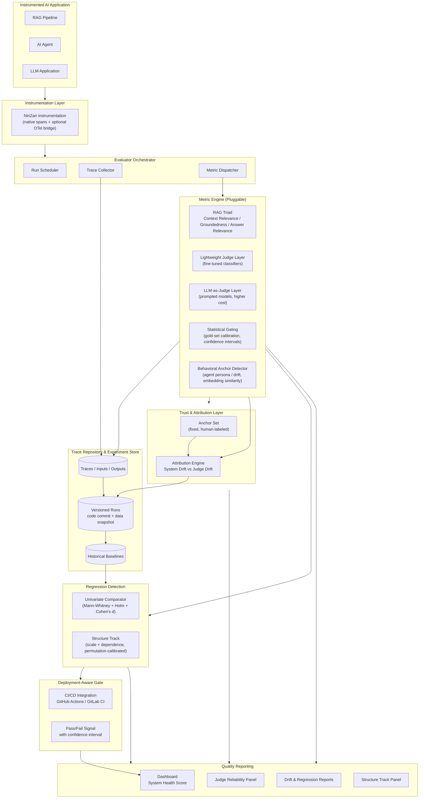
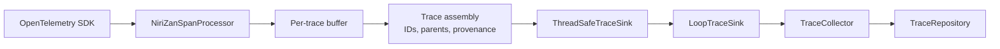

# NiriZan Architecture

This document describes the proposed system architecture for NiriZan, a continuous evaluation infrastructure for production AI systems. It translates the literature review findings and architecture research into concrete components, data flow, and design decisions.

> **Note on sourcing:** Some components below (the attribution monitor, behavioral anchor detector, and statistical gating approach) are inspired by research patterns identified during literature research and are referenced by descriptive name rather than as confirmed, individually verified citations. Treat these as design inspiration to validate against primary sources before finalizing implementation details.

---

## 1. Design Principles

NiriZan's architecture is guided by five principles, derived directly from the literature review:

1. **Probabilistic systems need statistical evaluation, not pass/fail assertions.** Every core component should produce a score with a confidence interval, not a boolean.
2. **Evaluation must not sit on the user-facing critical path.** Instrumentation and judging happen out-of-band from the application response.
3. **A quality drop can come from the system or the judge.** The architecture must be able to tell these apart.
4. **Different domains need different metrics, but one pipeline.** RAG, agents, and general LLM apps should flow through the same orchestration and tracking layer, not separate silos.
5. **Support both reference-free and reference-based evaluation.** Production monitoring favors reference-free (no ground truth available at scale); pre-deployment benchmarking favors reference-based (gold answers available).

---

## 2. High-Level System Design

---

## 3. Component Breakdown

### 3.1 Instrumentation Layer

**Purpose:** Capture what actually happened inside a RAG pipeline, agent, or LLM call, at a granular enough level to localize failures.

- Native NiriZan instrumentation records separate spans for planning, retrieval, tool use, and generation.
- The optional OpenTelemetry adapter provides both directions of interoperability:
  `NiriZanToOTelExporter` exports validated NiriZan traces to an OTel tracer,
  while `NiriZanSpanProcessor` buffers completed OTel spans and assembles
  validated NiriZan traces.
- The adapter is isolated behind the optional `otel` dependency group.
  Applications that do not install that extra retain the core instrumentation
  and trace contracts unchanged.
- Runs as a lightweight SDK hook in the target application. Native tracing awaits its configured exporter when the root span closes; exporters such as the collector adapter can then queue persistence asynchronously, while the OTel `LoopTraceSink` remains non-blocking on the processor thread.
- Exported roots and orphaned parent links use a synthetic remote OTel parent
  by default so one NiriZan trace remains one OTel trace. Export order is
  parent-first and preserves explicit in-trace parent contexts.
- Content-bearing attributes are opt-in in both directions. Structural metadata
  is retained by default; prompts, completions, retrieval data, tool arguments,
  and planning content require an explicit capture setting.
- **Design decision:** the bridge is an optional dependency group, not a
  soft dependency. Core packages are forbidden from importing either
  `opentelemetry` or the adapter, by import-linter contracts and by an AST
  scan that also covers the root package. That is why
  `SYNTHETIC_PARENT_ATTRIBUTE` and the other shared constants live in core and
  the adapter imports them from there: a core-only install has to be able to
  carry data the bridge produced (a synthetic-parent marker is plain core
  data), so the marker cannot live in the adapter.
- **Design decision:** persistence and OTel delivery are decoupled from the request/response cycle where the configured adapter supports queueing. The core `Tracer` does not create a background task automatically: it awaits its configured exporter inline when the root span closes.

#### OpenTelemetry ingest and delivery flow

The processor's synchronous callback never writes directly to the async
collector queue. `LoopTraceSink` schedules delivery onto the collector's event
loop, so the OTel consumer thread remains non-blocking. Trace validation rejects
cross-trace spans and unmarked dangling parents. A missing local OTel parent is
marked synthetic only when `orphan_policy="emit"`; children of dropped,
unrecognized, duplicate, or unconvertible spans are re-attached to surviving
ancestors without being marked synthetic solely because of that re-attachment.

#### How OTel isolation is verified

The optional extra is a promise about what a core-only install does, so it is
verified as a set of independent layers rather than by a single test:

| Layer | What it pins | Where |
|---|---|---|
| L1 | Every core module imports, and a full tracer to collector to SQLite pipeline runs, with `opentelemetry*` imports blocked in a subprocess; `to_otel` and `from_otel` raise a plain `ImportError` naming the missing package | `tests/test_otel_isolation.py` |
| L2 | The *installed* distribution gates every OpenTelemetry requirement behind `extra == "otel"`, and the core requirement set is unchanged | `tests/test_otel_isolation.py` |
| L3 | The orchestrator boundary is OpenTelemetry-blind: the collector, the thread-hop sink, and a real SQLite repository round trip a synthetic-parent trace on a real event loop, and closed-loop, failing-collector, and failing-repository paths stay isolated | `tests/orchestrator/test_otel_boundary_isolation.py`, `tests/orchestrator/test_loop_sink.py` |
| L4 | Storage persists OTel-shaped traces (synthetic parents, provenance attributes, recovered session IDs) with no OpenTelemetry dependency | `tests/storage/test_otel_storage_boundary_isolation.py` |
| L5 | Buffer caps and stats hold on every intake path, including the shutdown drain, and under eight concurrent producer threads | `tests/instrumentation/otel/test_processor_lifecycle_isolation.py` |
| L6 | Round-trip fidelity: the two adapters are inverses on real trace shapes, and `capture_content=False` covers known content attributes without filtering custom ones | `tests/instrumentation/otel/test_conversion_roundtrip_isolation.py` |
| L7 | With both directions on one provider there is no export/ingest feedback loop, the core trace shape is identical with the bridge active and unused, and export does not mutate its input | `tests/instrumentation/otel/test_tracer_exporter_isolation.py` |

Two static layers sit alongside the dynamic ones: an AST scan of the core
package for any import of `opentelemetry` or the adapter (independent of the
linter contracts, so it also covers `nirizan/__init__.py`, which cannot be a
contract source), and `import-linter`'s forbidden and layers contracts in
`pyproject.toml`. CI runs the suite twice over: once with the extra installed
and once without, on the minimum supported Python and the latest stable, and
the core-only legs assert that `import opentelemetry` fails before running the
suite. What the bridge *promises* is written down in
[`contracts.md`](contracts.md#open-telemetry-adapter-contracts-instrumentationotel);
this section covers only how the boundary is enforced.

### 3.2 Evaluator Orchestrator

**Purpose:** The control plane that manages the lifecycle of an evaluation run.

- **Run Scheduler:** triggers evaluation runs (on-demand, scheduled, or in response to a percentage of live production traffic).
- **Trace Collector:** ingests spans from the instrumentation layer into the Trace Repository.
- **OTel delivery path:** `LoopTraceSink` adapts the processor's synchronous
  trace sink to the collector's async queue and logs delivery failures rather
  than allowing them to escape from the OTel consumer thread.
- **Metric Dispatcher:** routes traces to the relevant metrics based on system type (RAG, agent, general LLM app).

### 3.3 Metric Engine (Pluggable)

This is intentionally modular so new metrics can be added without changing the orchestration layer.

| Module | What it does | When to use |
|---|---|---|
| RAG Triad | Context relevance, groundedness, answer relevance | RAG pipelines, reference-free |
| Lightweight Judge Layer | Fast, cheap fine-tuned classifiers (e.g. DeBERTa-scale) trained on synthetic in-domain pairs | High-volume production monitoring where LLM-judge cost is prohibitive |
| LLM-as-Judge Layer | Prompted larger models scoring outputs | Pre-deployment benchmarking, lower-volume evaluation, cases needing nuanced judgment |
| Statistical Gating | Calibrates lightweight judge output against a small human-labeled gold set, producing confidence intervals | Deployment gates that need a high-confidence pass/fail signal |
| Behavioral Anchor Detector | Embedding similarity between prompts/responses and labeled "aligned" vs "deviation" anchor sentences | Long-session agents, detecting persona or constraint drift |

**Design decision:** reference-free metrics (RAG Triad, anchor detection) run continuously against production traffic. Reference-based metrics (accuracy against gold answers, AgentBench-style task completion) run at pre-deployment or scheduled benchmark stages, since gold answers aren't available for live traffic.

### 3.4 Trust & Attribution Layer

**Purpose:** Answer the question "did the system get worse, or did the judge change?"

- **Anchor Set:** a small, fixed, human-labeled set of queries and expected responses, re-scored at a steady rate alongside production traffic.
- **Attribution Engine:** compares current judge behavior on the anchor set against historical judge behavior. Produces a five-state verdict: no drift, system drift, judge drift, joint drift (both system and judge shifted significantly), or inconclusive (an input distribution was empty or contained non-finite values).
- **Design decision:** this layer exists specifically because judge models (especially third-party API-based judges) can change silently, and conflating judge drift with system regression would make every other part of the pipeline untrustworthy.

### 3.5 Trace Repository & Experiment Store

**Purpose:** Source of truth for everything measured.

- Stores raw traces, inputs, intermediate retrieval steps, and final outputs.
- Trace upserts preserve existing trace rows and update spans only when the
  existing span belongs to the same trace; a span ID collision across traces
  raises instead of stealing or replacing the existing span. A save replaces
  the trace's stored span set with the incoming one.
- Parent links are integrity-checked at the model boundary. Missing parents
  are allowed only when an ingest adapter marks the link with the synthetic
  parent attribute.
- Every run is versioned against a specific code commit and data/prompt configuration snapshot, so any two runs are comparable.
- Maintains historical baselines used by the Regression Detector.

#### Timestamp storage form

**Why canonical UTC text.** Every timestamp is written as `datetime.isoformat()`
of the value converted with `astimezone(UTC)`, so a stored row reads back as
one canonical string regardless of the offset the writer happened to use. The
write path rejects a naive datetime outright, because a naive value has no
single correct interpretation and guessing one at write time is how a database
ends up with two rows that claim to be at the same instant but are not.

**Why `julianday()`.** SQLite has no native timestamp type, so ordering and
range filtering on stored text depend on every writer using the same offset,
which cannot be assumed for rows written before the canonical-UTC policy or by
anything outside this code path. `julianday()` parses an ISO-8601 string into a
Julian day number and normalizes the offset away, which gives SQL a true
instant for both legacy and canonical rows, so listing and purge compare by
instant rather than by string. Its cost is resolution: a Julian day number is a
floating-point value whose precision is around one millisecond, so SQL can only
separate two rows whose instants differ by more than a millisecond. That limit
applies to traces and to spans alike, but the two are handled differently.

Spans of one trace are re-sorted in Python on the exact instant, so span
ordering is exact and the SQL ordering is only a coarse pre-sort. That two-stage
ordering is a deliberate trade: exact span semantics in exchange for one extra
sort of the rows of a single trace.

Trace listing is ordered and paginated entirely in SQL, with SQL `LIMIT`/`OFFSET`,
so it has no second pass to re-sort in. Two traces whose instants land in the
same millisecond are therefore separated by the SQL tiebreaks (stored text, then
`trace_id`) rather than by their exact instants. For rows written since the
canonical-UTC policy that distinction is a formality: stored text order and
instant order agree for canonical UTC rows, so the tiebreak never reorders them.

**Indexing.** `idx_traces_app_julianday` is an expression index on
`(application_name, julianday(created_at))`, so the instant-ordered listing
query is satisfied by the index rather than by scanning and sorting every trace
row of the application. The span-level ordering has no expression index: it is
scanned over the rows of one trace (bounded by `idx_spans_trace_id`), which is
small enough that a scan plus a Python sort is cheaper than maintaining another
index.

**Malformed rows.** A stored timestamp that is not ISO-8601 at all is never
guessed at. A read raises `ValueError` naming the stored text, because a
silently dropped or coerced timestamp is indistinguishable from a correct one.
Purge fails loudly for the same reason: `julianday()` returns NULL for such a
row, and a NULL never compares less than a cutoff, so the row would survive
every purge forever while looking protected.

**Ordering tiebreaks.** Listing orders by instant descending, then by stored
`created_at` text descending, then by `trace_id` ascending. Stored text is a
sound tiebreak for the rows this repository writes, because canonical UTC
ISO-8601 text sorts in the same order as the instants it represents, so the
tiebreak never reorders a canonical row; it only decides the order of legacy
rows that share a millisecond. The resulting order is total, so pagination
returns every trace exactly once with no gaps. Spans order by start instant,
then by parent depth (a parent precedes its children when a coarse clock gives
them the same start), then by stored order. Stored order, not `span_id`, is the
final tiebreak: it is the one key that is always defined, and it never invents
a timestamp. The guarantees these tiebreaks produce for callers are stated in
[`contracts.md`](contracts.md#basetracerepository-interface-storagetrace_repositorypy),
not restated here.

### 3.6 Regression Detection

**Purpose:** Detect quality drops between versions or over time.

Two complementary tracks run against the same baseline/candidate pair of score matrices:

- **Univariate track** (`regression/comparator.py`). Per-metric Mann-Whitney U with Holm-Bonferroni correction and Cohen's d effect gating. This is the primary decision signal and the only track that has historically driven the deployment gate. It is one-sided (fires only on degradation, not improvement) and its verdicts carry a signed effect size.
- **Structure track** (`regression/multivariate.py`). Two permutation-calibrated tests targeting changes the univariate track is blind to, per the internal N=3000 ablation study:
  - `scale`: variance-only change, computed as a permutation test on the sum of squared log-variance ratios across metrics. The univariate track fires on this at roughly its nominal false-alarm rate (2.3%), i.e. it has no power to detect it.
  - `dependence`: rank-correlation change, computed as a permutation-calibrated maxT of the off-diagonal differences between the two groups' rank-correlation matrices. A pure copula shift leaves every marginal unchanged, so the univariate track has no information about it by construction. Rank correlation is used rather than covariance Frobenius specifically because the ablation showed covariance Frobenius leaks variance changes into the dependence test.

  The two structure tests are combined with Holm-Bonferroni at the structure track's alpha, and both are inherently **undirected** — a variance increase and a variance decrease of equal magnitude produce the same test statistic.

- **Regime handling.** Below `min_complete_rows` complete cases, the structure track emits an `INCONCLUSIVE` verdict rather than a silent pass, mirroring the `AttributionVerdict.INCONCLUSIVE` contract in the Trust layer. Zero-variance columns are instead handled by the scale statistic's epsilon floor.

- Feeds both the deployment gate (blocking, subject to mode limits below) and the reporting layer (informational).

### 3.7 Deployment-Aware Gate

**Purpose:** Let evaluation results actually block or approve a release, not just report on it after the fact.

- Integrates with CI/CD (GitHub Actions, GitLab CI, or similar) as a build step.
- Emits a pass/fail signal with an attached confidence interval, not just a raw score, so teams can set risk-appropriate thresholds.
- **Two-track authority.** `GateVerdict.multivariate_verdicts` carries the structure track's verdicts alongside `regression_verdicts` (the univariate track). `passed` flips to `False` on any `BLOCKING` verdict from either track. Structure verdicts do not participate in `select_decision_metric`, which is univariate-only by design.
- **Structure track mode caps its authority.** The structure track runs in one of two modes (see `MultivariateConfig.mode`):
  - `BALANCED` (default): the structure track may raise `WARNING`, never `BLOCKING`. `GateVerdict.passed` is never flipped by a structure verdict in this mode. The reason is directionality: a variance change that is an improvement and one that is a regression produce the same test statistic, so a BLOCKING structure verdict would fail a release on a change that might be desirable. WARNING severity surfaces the signal to a human without gating on it automatically.
  - `STRICT` (opt-in): the structure track may raise `BLOCKING`. The caller is responsible for carving the structure track's alpha out of the same budget the univariate comparator spends, because the ablation showed that any second block-capable track inflates the gate's worst-configuration false-alarm rate above the nominal 5% unless the alpha is shared.

### 3.8 Quality Reporting

**Purpose:** Make results visible and actionable for engineering teams.

- **System Health Score:** an aggregated view combining retrieval relevance, agent plan quality, and drift signals into one summary metric, inspired by aggregation approaches used in tools like Deepchecks.
- **Judge Reliability Panel:** tracks judge consistency and bias longitudinally, as a first-class, dashboarded metric rather than an afterthought.
- **Drift & Regression Reports:** surfaces what changed, when, and whether it was attributed to the system or the judge.
- **Structure Track Panel:** surfaces the multivariate structure verdicts alongside the univariate verdicts in `DashboardSnapshot.multivariate_verdicts`. Structure verdicts are reported as informational context and deliberately **do not participate in the numeric health score**: a directionless signal cannot honestly be reduced to a scalar degradation value, and folding it in would either require picking a direction (wrong, since the tests are undirected) or double-counting univariate signals that already flow into the score.

---

## 4. Key Architectural Tensions and How NiriZan Resolves Them

| Tension | Positions in the literature | NiriZan's approach |
|---|---|---|
| Reference-free vs. reference-based evaluation | RAGAS/TruLens favor reference-free; AgentBench/HELM rely on gold references | Support both: reference-free for continuous production monitoring, reference-based for pre-deployment benchmarking |
| Static vs. living benchmarks | Static benchmarks risk data leakage and memorization; some proposals favor continuously refreshed evaluation sets | Support living data pipelines so benchmark data can be refreshed rather than going stale |
| Judge agreement metrics | Raw exact-match agreement overstates judge quality; Cohen's kappa is a more honest metric; position bias affects even strong models | Track judge reliability (including bias and consistency) as its own longitudinal metric, not just a one-time validation step |
| Cost vs. accuracy of judging | LLM-as-judge is accurate but expensive at scale; lightweight classifiers are cheap but need calibration | Use lightweight judges for volume, calibrate against a small gold set with statistical gating, reserve LLM-as-judge for lower-volume, higher-stakes evaluation |
| Directed vs. undirected regression signals | Per-metric tests are one-sided and carry a direction; structure tests (variance, dependence) are undirected | Keep both tracks, but cap the structure track at `WARNING` in the default `BALANCED` mode so an undirected signal never blocks a release automatically |

---

## 5. Identified Gaps NiriZan Aims to Fill

1. **Unified RAG + agent + drift pipeline.** Most existing tools specialize in one domain; NiriZan aggregates retrieval quality, agent behavior, and drift into a single pipeline and health score.
2. **Judge-reliability tracking as a first-class, dashboarded metric**, not a one-off audit.
3. **Integrity-checked evaluation.** Guard against benchmark gaming (e.g. an agent reading reference answers directly rather than solving the task) through integrity-checking analysis modules.
4. **Data freshness and ownership signals.** A RAG system can score well on faithfulness while still answering from stale or unowned data; NiriZan should track data freshness/ownership metadata alongside inference-layer scores.
5. **Structure-aware regression detection.** The univariate ablation study showed that per-metric tests are blind to variance-only and dependence-only degradations at the FAR-eligible operating point. NiriZan's structure track exists specifically to cover those two cases, and only those two cases, without reopening the false-alarm budget the univariate track already spends.

---

## 6. Summary Table for Design Doc Reference

| NiriZan Component | Inspiration | Problem Solved |
|---|---|---|
| Evaluator Orchestrator | AgentBench-style multi-environment testing | Coordinating multi-turn, multi-domain evaluation runs |
| Statistical Gating | Prediction-powered inference (PPI) style calibration | High-confidence regression gating at low cost |
| Attribution Engine | Judge-vs-system drift attribution research | Disambiguating whether a score drop is the system or the judge |
| Behavioral Anchor Detector | Embedding-based persona/behavior monitoring | Real-time agent drift detection, cheap enough for continuous use |
| Holistic Reporter | HELM's multi-metric, multi-scenario visibility model | Giving teams one place to see overall AI system quality |
| Structure Track | Internal N=3000 ablation of the multivariate structure tests | Detecting variance-only and dependence-only degradation that univariate tests miss, without reopening the false-alarm budget |
